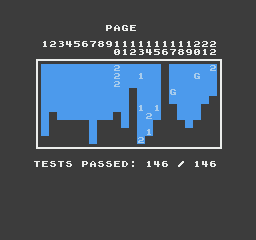

# CipherNES

**A native, cross-platform NES and Famicom emulator**  
Version **1.0.0** · Created by **Jacob Hodgkins / HodgkinsStudios** · [MIT License](LICENSE)

CipherNES is a C++ NES/Famicom emulator for **Linux, Windows, and macOS**. It combines a shared, timing-oriented NES emulation core with SDL2 desktop frontends. The project supports cartridge and Famicom Disk System software, configurable input, save states, and playback tools.

> **Bring your own games:** CipherNES does not include commercial game ROMs, proprietary FDS firmware, or third-party test ROMs.

## Highlights

- **NES hardware emulation:** 6502 CPU, 2C02 PPU, 2A03 APU, mapper implementations, iNES/NES 2.0 cartridge images, and Famicom Disk System support (with a user-supplied BIOS).
- **Desktop integration:** system file pickers on supported desktops, drag-and-drop loading of `.nes`, `.fds`, `.qd`, and `.zip` inputs, keyboard and gamepad mapping, and multiple controllers.
- **Game management:** save slots, screenshots, Game Genie cheats, configurable audio channels, and optional forward-only AVI capture.
- **Timeline controls:** frame-by-frame rewind with captured reverse PCM audio, plus hold-to-fast-forward at **150%** without skipping emulated frames.
- **TAS tools:** input recording and playback with branch-aware rewind and save-state handling.
- **Display options:** windowed, aspect-correct fullscreen, and stretched fullscreen modes. **Esc** cycles display modes.

For keyboard shortcuts, file compatibility, limitations, and transport behavior, see the [features and controls guide](docs/FEATURES.md).

## Download and build

Download prebuilt binaries from [GitHub Releases](https://github.com/HodgkinsStudios/CipherNES/releases), or build the application using the platform-specific scripts below.

| Platform | Build entry point | Output / distribution |
| --- | --- | --- |
| Ubuntu / Linux | `./build_ubuntu.sh` | `build/ubuntu/bin/CipherNES` (core built in) |
| Windows (MinGW-w64) | `build_windows.bat` or `build_windows.ps1` | `build/windows/bin/CipherNES.exe` (embedded SDL2/zlib) |
| macOS (Intel / Apple Silicon) | `./build_macos.sh` | `build/macos/CipherNES.app` and standalone Mach-O |
| Linux packages | GitHub Actions or packaging scripts | AppImage, Debian `.deb`, Flatpak bundle |

The Linux build requires a C++ toolchain, SDL2, and zlib; installing `zenity` or `kdialog` enables the desktop file picker. Platform requirements and packaging guidance are documented in [docs](docs/README.md). FDS firmware must be supplied separately by the user.

## First launch and user data

CipherNES creates its writable directories **on the first launch**, independently of the executable's location. Release packages do not include empty save/BIOS directories or any proprietary firmware.

| System | Application data root |
| --- | --- |
| Linux | `~/.local/share/HodgkinsStudios/CipherNES/` |
| Windows | `%APPDATA%\HodgkinsStudios\CipherNES\` |
| macOS | `~/Library/Application Support/HodgkinsStudios/CipherNES/` |

The first launch creates `Saves`, `SaveState`, `Screenshots`, `Videos`, `Cheats`, `TAS`, `bios`, `roms`, `config`, and `logs`. Save RAM, save states, screenshots, recordings, game configurations and FDS BIOS lookups use this root, not the program directory. Place a user-owned, legal 8192-byte FDS BIOS as `bios/disksys.rom` beneath the indicated root. Existing files previously stored beside the old executable can be moved into the corresponding new directories manually. CipherNES never bundles or automatically relocates a BIOS.

For isolated testing, set `CIPHERNES_RUNTIME_DIR` to an absolute temporary directory. It overrides the normal root on all three systems.

## Portable executables

- **Windows:** `CipherNES.exe` is a single distributable PE file containing the emulator core, SDL2, zlib and supporting DLL bytes as resources. On launch, it verifies and extracts the bundled DLLs into the per-user `runtime/` subdirectory; no second release file is needed.
- **macOS:** the command-line runnable `CipherNES-macOS-<arch>-portable` contains the core and SDL2 runtime dylib bytes. They are unpacked into the per-user `runtime/` directory when launched. A conventional `CipherNES.app` bundle is also provided for Finder integration. Apple Gatekeeper may require the customary signing/notarization flow for public distribution.
- **Linux:** the **AppImage is the recommended single-file portable distribution** and bundles application/runtime libraries. The small native `CipherNES` executable also links its emulator core internally but still requires host SDL2/zlib and the usual system libraries; the `.deb` and Flatpak installers manage their own runtime dependencies.

## Accuracy and validation

The trimmed Ubuntu 1.0 core completed the **AccuracyCoin test ROM with 146 / 146 tests passed**. The screenshot below is a record of that run.

A separate NTSC test-ROM archive audit successfully loaded **289 / 289 valid iNES images**, executed each for 600 frames, and completed state save/restore checks. **This archive result is a smoke test, not proof that all 289 ROMs reported their own internal PASS conditions.**

The corresponding GitHub Actions run completed successfully for Ubuntu, Windows, macOS Intel and Apple Silicon, AppImage, Debian, and Flatpak on **October 22, 2026** (commit `a65eee455`). CI results demonstrate successful builds and configured automated checks; they do not replace physical-device testing of audio, input, fullscreen behavior, or Flatpak file dialogs.

Read the [validation methodology](docs/VALIDATION.md), [historical NTSC accuracy results](docs/NTSC_ACCURACY.md), and [mapper compatibility reference](docs/NTSC_MAPPERS.md) for the scope and limits of these claims. The external test suite is credited to [christopherpow/nes-test-roms](https://github.com/christopherpow/nes-test-roms); its ROMs are **not redistributed** here.

## Documentation

- [Documentation index](docs/README.md) — installation, features, architecture, compatibility, and testing.
- [Windows build guide](docs/WINDOWS.md) and [macOS build guide](docs/MACOS.md).
- [GitHub release procedure](docs/GITHUB_RELEASE.md), [build status](docs/BUILD_STATUS.md), and [v1.0.0 release notes](RELEASE_NOTES_1.0.0.md).
- [Core API reference](docs/CORE_LIBRARY.md) and [system architecture](docs/SYSTEM_ARCHITECTURE.md).

## License and third-party software

CipherNES is licensed under the [MIT License](LICENSE). Review [third-party notices](THIRD_PARTY_NOTICES.md) for dependencies and acknowledgements. **No game ROMs, test suites, user save data, or proprietary BIOS images are included.**
