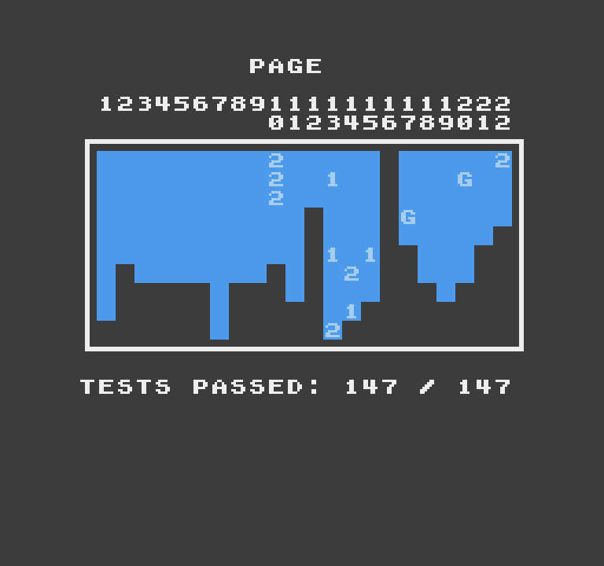

<p align="center">
  
</p>

<h1 align="center">CipherNES</h1>

<p align="center">
  <strong>A native NES / Famicom emulator built for accuracy.</strong><br />
  A shared emulation core. Native desktop frontends. No game-specific compatibility hacks.
</p>

<p align="center">
  
  
  
  
</p>

<p align="center">
  <a href="#getting-started">Get started</a> ·
  <a href="#features">Features</a> ·
  <a href="#accuracy--validation">Accuracy</a> ·
  <a href="#developer-test-roms">Testing</a> ·
  <a href="#documentation">Documentation</a>
</p>

---

## AccuracyCoin · 147 / 147 passed

<p align="center">
  
</p>

<p align="center"><sub>Captured directly from CipherNES 1.0.0, running AccuracyCoin's complete combined test sequence. Original 256 × 240 framebuffer, enlarged 3× using nearest-neighbor scaling; no results were edited.</sub></p>

**147 of 147 AccuracyCoin tests passed** on the Ubuntu build. The run processed all tests at frame **4,172** and passed a save-state roundtrip. AccuracyCoin is a stringent hardware test for a specific NTSC NES hardware revision; this result does **not** imply perfect compatibility with every cartridge or console revision.

## About CipherNES

CipherNES emulates the Nintendo Entertainment System and Famicom using a native emulation core shared across its Linux, Windows, and macOS frontends. Its approach is hardware-focused: CPU execution, PPU rendering, APU audio, DMA, interrupts, cartridge boards, and their interactions are modeled without title-specific fixes.

### Features

| Category | Capabilities |
| --- | --- |
| **Emulation** | NTSC-targeted 2A03 CPU, 2C02 PPU, APU and cartridge/mapper support |
| **Cartridges** | NES/iNES and NES 2.0 ROM loading, ZIP cartridge loading, battery saves |
| **Disk games** | Famicom Disk System support with a **user-supplied** BIOS |
| **Controls** | Keyboard and gamepad, hot-plug detection, configurable mappings |
| **Display** | Windowed, aspect-correct fullscreen, and stretched fullscreen |
| **Convenience** | Save/load states, frame rewind, fast-forward, Game Genie cheats |
| **Advanced** | Input recording (TAS), image/video capture and a reusable native core interface |

Mapper registration is broader than fully verified board accuracy. Some specialized hardware configurations and raster/audio timing behaviors still need validation; see [Mapper coverage](docs/NTSC_MAPPERS.md).

## Getting started

### Ubuntu / Linux

From the repository root:

```bash
sudo apt update
sudo apt install -y build-essential libsdl2-2.0-0 zlib1g zenity
./build_ubuntu.sh
./build/ubuntu/bin/CipherNES
```

Use **File → Open** to load a legally obtained NES ROM. You can also use the provided `run_ciphernes.sh` launcher. The regular Linux executable links the emulator core into the binary and uses system runtime libraries.

### Windows and macOS

| Platform | Build entry point | Notes |
| --- | --- | --- |
| Windows | `build_windows.bat` or `build_windows.ps1` | MinGW-w64/SDL2/zlib build tooling; [Windows guide](docs/WINDOWS.md) |
| macOS | `./build_macos.sh` | Apple command-line tools and SDL2; [macOS guide](docs/MACOS.md) |
| Linux packages | `./package_release.sh` | Native release ZIP; other packaging scripts in `packaging/` |

Build scripts and GitHub Actions workflows are included for these platforms. **This AccuracyCoin result was measured on Ubuntu; it is not a claim that every platform package has been independently tested.**

### Common controls

| Action | Default |
| --- | --- |
| Switch display mode | `Esc` — windowed → fullscreen → stretched → windowed |
| Rewind | Hold `R` |
| Fast-forward | Hold `T` |
| Open a game | **File → Open** |
| Configure controller | **Configure → Controller Input** |
| Save and load state | Application's state-slot controls |

Keyboard and gamepad mappings are configurable. See [Features and controls](docs/FEATURES.md) for constraints involving TAS recording and capture.

## Accuracy & validation

CipherNES reports **measured results**, rather than treating mapper registration or a ROM boot as proof of accuracy.

| Validation | Result | Scope |
| --- | --- | --- |
| **AccuracyCoin combined tests** | **147 / 147 PASS** | Complete suite, final result screen captured on this 1.0.0 Ubuntu build |
| **NTSC test-ROM execution & save-state baseline** | **274 / 274** | 600 frames each; 15 PAL and one invalid image excluded; not internal PASS grading |
| **Mapper smoke registry** | **156 / 156** | Registered mapper-ID initialization and execution coverage |
| **Mapper regression assertions** | **7,156 / 7,156** | Synthetic mapper behavior checks |
| **Host audio / rewind** | Pass | Release regression checks |

The NTSC corpus totals above are from a fresh run on the 1.0.0 Ubuntu build. Mapper, audio and rewind figures are documented release-validation results, not claims of a new rerun in the NTSC pass.

**NTSC test-ROM execution baseline:** **274/274** NTSC `.nes` ROMs successfully executed 600 frames and restored state on the 1.0.0 Ubuntu build; **0** execution/state failures. This is a **smoke/regression baseline, not an internal accuracy score**. Previously source-graded internal results include **175 PASS**, **one visual mismatch**, and **98 not fully adjudicated**; those internal grades were not freshly rerun in this batch. See the [full 274-ROM baseline and per-ROM CRCs](docs/NTSC_TEST_ROM_BASELINE.md).

**Known boundaries:** NTSC is the primary timing target; PAL accuracy is not claimed. A documented `nmi_sync/demo_ntsc.nes` visual alignment discrepancy of three pixels remains unresolved. MMC5's fine-grained raster and analog audio behavior has not been fully verified. External ROM smoke tests and visual demos must not be counted as internal pass/fail scores.

Reproduce the displayed AccuracyCoin screen with the bundled owner-supplied test ROM:

```bash
./tests/run_accuracycoin.sh TEST_ROMS/AccuracyCoin.nes /tmp/accuracycoin-final.ppm
```

The runner saves the framebuffer as a PPM file. Inspect its final screen to confirm the tally; **147 test entries processed** alone is not evidence that all 147 passed.

## Developer test ROMs

`TEST_ROMS/` stores developer-supplied test material and source/reference data. GitHub Actions includes a manually triggered **Test ROM corpus** workflow under **Actions → Test ROM corpus (manual) → Run workflow**. That workflow supports execution/save-state smoke testing and an optional full AccuracyCoin capture; ROM execution does not automatically establish an internal PASS verdict.

> [!IMPORTANT]
> Test ROMs, reference data, and FDS firmware may have licenses or redistribution restrictions separate from CipherNES. **Check permissions before publishing `TEST_ROMS/` in a public GitHub repository.** The recommended default for a checkout containing these files is a private repository. Firmware is not supplied by CipherNES.

See the [NTSC 274-ROM baseline](docs/NTSC_TEST_ROM_BASELINE.md), [test ROM documentation](TEST_ROMS/README.md) and [third-party notices](THIRD_PARTY_NOTICES.md).

## Documentation

| Guide | Contents |
| --- | --- |
| [Features](docs/FEATURES.md) | Controls, save states, rewind, fast-forward and recording |
| [Architecture](docs/SYSTEM_ARCHITECTURE.md) | Shared core and platform frontends |
| [Core API](docs/CORE_LIBRARY.md) | Reusable native emulation interface |
| [Builds & runtime storage](docs/PORTABLE_RUNTIME.md) | Per-platform application directories and dependencies |
| [Validation](docs/VALIDATION.md) | Test procedures and accuracy limitations |
| [NTSC test-ROM baseline](docs/NTSC_TEST_ROM_BASELINE.md) | 274-ROM execution results, limitations, reproducibility and per-ROM evidence |
| [Mapper coverage](docs/NTSC_MAPPERS.md) | Registry, tested features and known limitations |
| [Release notes](RELEASE_NOTES_1.0.0.md) | Version 1.0.0 release overview |

## License

CipherNES source code is released under the [MIT License](LICENSE). Copyright © 2026 HodgkinsStudios. Third-party test ROMs, firmware, and other external materials are **not** covered by that grant unless their own licenses say so.

*Nintendo, Famicom, and NES are trademarks of their respective owners. CipherNES is an independent emulator project and is not affiliated with or endorsed by Nintendo.*
