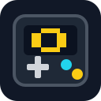
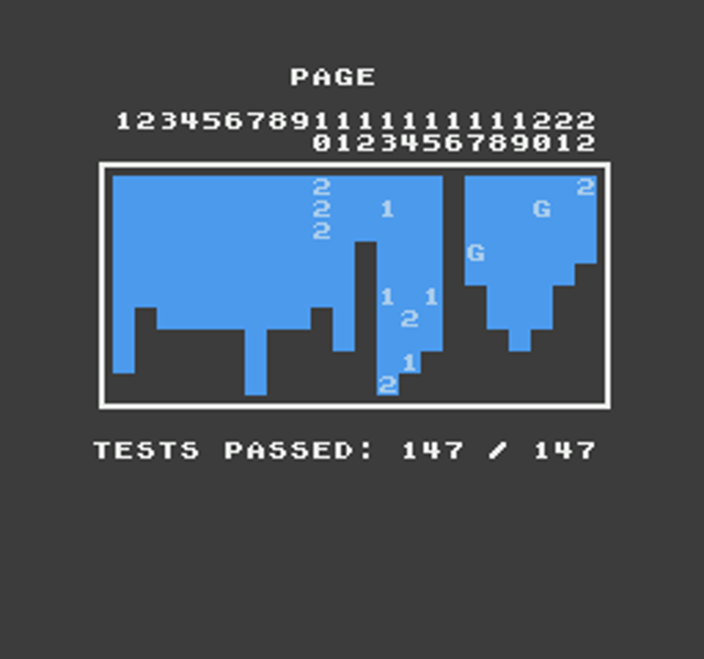

<p align="center">
  
</p>

<h1 align="center">CipherNES</h1>

<p align="center">
  <strong>A native NES / Famicom emulator focused on hardware accuracy.</strong><br />
  One emulation core. Desktop frontends for Linux, Windows and macOS. No game-specific workarounds.
</p>

<p align="center">
  
  
  
  
</p>

<p align="center">
  <a href="#features">Features</a> ·
  <a href="#getting-started">Getting started</a> ·
  <a href="#accuracy-and-validation">Accuracy</a> ·
  <a href="#documentation">Documentation</a> ·
  <a href="#license">License</a>
</p>

---

## AccuracyCoin — 147 / 147 passed

<p align="center">
  
</p>

<p align="center"><sub>Actual CipherNES Ubuntu capture, 147 / 147 displayed PASS. Original NES framebuffer enlarged with nearest-neighbor scaling; test output was not altered.</sub></p>

CipherNES passed **147 out of 147 AccuracyCoin tests** in the most recently verified full Ubuntu run. The broader NES test-ROM corpus has **197 PASS, 7 FAIL and 70 UNVERIFIED** NTSC entries out of 274; passing entries include explicitly scoped functional demonstrations, and unverified entries are not treated as passes. These measurements are **not** claims of perfect NES compatibility or independently verified performance on every platform.

**[Read the complete accuracy methodology, test results and limitations](docs/TESTING.md).**

## Features

| Area | Included functionality |
| --- | --- |
| **Emulation** | NTSC-targeted CPU, PPU, APU, DMA, interrupts and cartridge-board behavior |
| **Games** | iNES / NES 2.0 images, supported ZIP containers and battery-backed saves |
| **Disk support** | Famicom Disk System with a separately supplied BIOS (firmware not included) |
| **Controls** | Keyboard and gamepad, hot-plugging and remappable inputs |
| **Video** | Windowed, aspect-correct fullscreen and stretched fullscreen |
| **Convenience** | Save/load states, rewind, fast-forward and Game Genie |
| **Advanced** | Input recording (TAS), screenshots, capture utilities and reusable native core API |

Mapper registration is not equivalent to verified compatibility with every board variation. See the [architecture](docs/ARCHITECTURE.md) and [testing guide](docs/TESTING.md) for coverage details.

## Getting started

### Ubuntu / Linux

```bash
sudo apt update
sudo apt install -y build-essential libsdl2-2.0-0 zlib1g zenity
./build_ubuntu.sh
./build/ubuntu/bin/CipherNES
```

Load a legally obtained `.nes` file or supported `.zip` archive through **File → Open**. The `run_ciphernes.sh` launcher is also available after building. `kdialog` can be used instead of `zenity` on appropriate desktops.

### Windows and macOS

| Platform | Build entry point | Additional information |
| --- | --- | --- |
| **Windows** | `build_windows.bat` or `build_windows.ps1` | Requires compatible MinGW-w64 / SDL2 build tools |
| **macOS** | `./build_macos.sh` | Requires Apple command-line tools and SDL2 |
| **Ubuntu/Linux** | `./build_ubuntu.sh` | Build verified on Ubuntu |

See [building and packaging](docs/BUILDING.md). The current validation evidence was collected on **Ubuntu**; Windows/macOS source targets and workflows exist, but native GUI/device testing is still required before publishing platform releases.

### Default controls

| Action | Default |
| --- | --- |
| Cycle windowed / fullscreen / stretched fullscreen | `Esc` |
| Rewind (hold) | `R` |
| Fast-forward (hold) | `T` |
| Configure controllers | **Configure → Controller Input** |

Input mapping, save data and other features are described in the [user guide](docs/USER_GUIDE.md).

## Accuracy and validation

| Recorded validation | Result | What it establishes |
| --- | --- | --- |
| **AccuracyCoin** | **147 / 147 PASS** | Graded result confirmed from the final on-screen score |
| **NTSC test-ROM verdicts** | **197 PASS / 7 FAIL / 70 UNVERIFIED** | 274 independently tracked entries; mixed test types, including functional demonstrations |
| **NTSC 600-frame smoke baseline** | **274 / 274** | Execution and state restoration only, **not 274 hardware-test passes** |
| **Mapper synthetic audit** | **156 mapper IDs / 7,156 assertions** | Registration and focused synthetic checks, not exhaustive board validation |

The result counts are **recorded development/validation baselines**, not a claim that the entire external corpus was rerun when this README was prepared. PAL timing, specialist controllers, analog composite video and some PPU/mapper cases remain incompletely verified.

Detailed descriptions of the seven failures, unverified tests, reproducibility procedures and third-party test credits are maintained in **[Accuracy and testing](docs/TESTING.md)**.

## Documentation

| Guide | Contents |
| --- | --- |
| [User guide](docs/USER_GUIDE.md) | Controls, file loading, saves and runtime behavior |
| [Building](docs/BUILDING.md) | Supported toolchains, platform builds and packaging |
| [Architecture](docs/ARCHITECTURE.md) | Shared core, hardware modules and mapper scope |
| [Accuracy and testing](docs/TESTING.md) | Test suites, measured results, limitations and credits |
| [Release preparation](docs/RELEASING.md) | QA checklist and release packaging |
| [Development](docs/DEVELOPMENT.md) | Regression tools and source-checkpoint workflow |
| [Release notes](RELEASE_NOTES_1.0.1.md) | What's included in v1.0.1 |

## License

CipherNES source code is distributed under the [MIT License](LICENSE). Copyright © 2026 HodgkinsStudios. See [third-party notices](THIRD_PARTY_NOTICES.md). No commercial game ROMs, third-party test-ROM binaries, FDS firmware, save files or compiled releases are included in the source repository.

*Nintendo, NES and Famicom are trademarks of their respective owners. CipherNES is an independent project and is not affiliated with or endorsed by Nintendo.*
