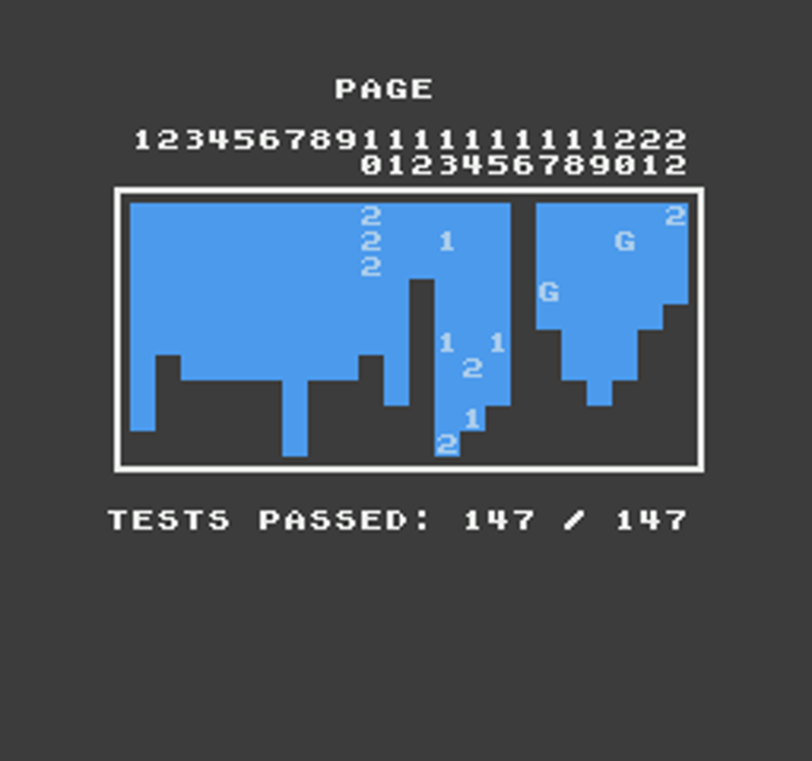

# Accuracy, testing and known limitations

CipherNES is an accuracy-oriented NES/Famicom emulator. This document records **observed evidence**, distinguishing a hardware test's own PASS result from a functioning demonstration or a ROM that merely executes without crashing. These tests are not an exhaustive hardware certification.

## At a glance

| Evaluation | Recorded outcome | Interpretation |
| --- | --- | --- |
| **AccuracyCoin** | **147 / 147 PASS (100%)** | Verified by reading the final score shown in an actual CipherNES Ubuntu framebuffer capture |
| **NTSC NES test-ROM verdicts** | **197 PASS / 7 FAIL / 70 UNVERIFIED** | 274 NTSC `.nes` entries. PASS includes objectively graded checks and *limited functional demonstrations*; those scopes are documented separately |
| **NTSC execution/state smoke** | **274 / 274** | 600 frames and successful state restoration each; **not** proof of internal hardware-test success |
| **PAL execution/state smoke** | **15 / 15** | Not evidence of correct PAL timing |
| **Mapper registry and synthetic audit** | **156 registered IDs / 7,156 passing assertions** | Coverage of selected mapper behaviors, not all submappers and PCBs |
| **Mapper 33 / state replay** | **44 / 48 passing assertions**, respectively | Distinct focused test suites; both passed in the last regression run |

**Evidence provenance:** AccuracyCoin was freshly verified after CP039 cleanup; the complete NTSC smoke baseline and the 197/7/70 per-ROM adjudication were established during preceding development checkpoints (CP030–CP038). The full external suite was **not** rerun for this v1.0.1 documentation pass. The source-only cleanup did not change the emulator core. The original detailed per-ROM evidence and screenshots are preserved in separate development checkpoints, not distributed with this public source tree.

## AccuracyCoin — 147/147 PASS



The screenshot is a captured CipherNES NES framebuffer with nearest-neighbor scaling; the results have not been edited. This demonstrates a complete PASS for the included AccuracyCoin combined test on the tested NTSC-oriented Ubuntu configuration. It does **not** establish perfect accuracy across all NES hardware revisions, untested cartridges, PAL models, platform ports, or analog display characteristics.

**Test origin and credit:** [100thCoin / AccuracyCoin](https://github.com/100thCoin/AccuracyCoin). The linked upstream repository is the source of the test program and its documentation. Credit and test-project licensing remain with the original project and contributors; AccuracyCoin is not part of the CipherNES code license.

**Reproducibility:** The original test was run with a separately acquired, lawfully held AccuracyCoin ROM and a development-only framebuffer capture harness. Those ROM and testing tools are intentionally **not included in the public release repository**. The actual final-screen image above remains available for inspection, and the complete test evidence is archived in the development checkpoints. Simply processing 147 test entries does not establish that all 147 passed.

## NES test-ROM suite — 197 PASS, 7 FAIL, 70 UNVERIFIED

**Suite origin and credit:** [christopherpow / nes-test-roms](https://github.com/christopherpow/nes-test-roms). The upstream repository provides the test-ROM corpus, explanations and source material used to interpret the results. Each ROM or collection may have its own author, license and documentation; review the upstream files and respect those terms. CipherNES does not claim authorship of those tests.

The recorded manifest contained **309 image entries** in total: 290 `.nes` suite images (274 NTSC, 15 PAL-labelled, one invalid iNES fixture); one separate AccuracyCoin image; two FDS, 13 NSF and three UNIF test images. Of the valid suite NTSC set, **197 were classified PASS, 7 FAIL and 70 UNVERIFIED**. A single recorded test-ROM pass can represent either a strict guest-coded hardware assertion or a documented *limited functional demonstration* (such as successful input, graphics, or an interactive test). Do not treat all 197 as equivalent in rigor.

The **274/274** 600-frame NTSC execution/state baseline tests that each ROM can run and restore a state, **not** that each ROM's internal test logic returns PASS. The 15 PAL-labelled ROMs also completed 600-frame smoke tests, but PAL timing was not graded. Both `.fds` images require a separately supplied 8 KiB FDS BIOS. NSF and UNIF are not supported by this particular validation path, and the one malformed-header NES image is an intentionally invalid input. None of these is silently counted as a hardware failure.

The two tests specific to the NEC MMC3A hardware-revision profile passed with that profile selected. Revision-specific default-profile mismatches are recorded separately instead of being conflated with inaccuracies for the intended variant.

### Seven remaining failing NTSC entries

| Test ROM | Observed failure or scope |
| --- | --- |
| `other/test28.nes` | Mapper 28 / Action 53 bank test reports a bus-conflict failure. Independent inspection suggests a possible older fixture/test contradiction. The emulator was **not** changed to emulate nonexistent bus conflicts. |
| `nmi_sync/demo_ntsc.nes` | On-screen NMI/scanline alignment differs from the documented reference by approximately 2–3 pixels. |
| `scanline/scanline.nes` | Source-defined mid-scanline raster indicator shows errors. |
| `scanline-a1/scanline.nes` | Byte-identical test image to the preceding path; same underlying issue, recorded as a second corpus entry. |
| `stress/NEStress.NES` | Interactive sprite-collision and limiter pages fail; its separate CPU pages show 48/48. |
| `stars_se/StarsSE.NES` | Persistent blank framebuffer; evidence suggests a frame-IRQ handling issue in the original ROM. Further independent verification is needed to separate emulator behavior from ROM compatibility. |
| `tvpassfail/tv.nes` | Expected analog NTSC composite crosstalk effect is absent from the raw RGB display output. This is a *presentation/filtering* limitation, not an assertion that CPU/PPU timing failed. |

**70 NTSC test entries remain UNVERIFIED**, not PASS or FAIL. Their remaining requirements include manual audio comparison, physical peripheral emulation, interactive programs, graphics demonstrations and reference checks not conclusively established. Hardware-profile differences, test-asset defects, and output-only filters are documented rather than masked with game-specific hacks.

## Reproducing release smoke checks

The public repository contains a production application and its build/packaging workflows, not the development ROM corpus, test runners or diagnostic tools. On Ubuntu:

```bash
./build_ubuntu.sh
./build/ubuntu/bin/CipherNES --help
```

With a legally obtained NES test ROM supplied separately, you may exercise the public headless validator:

```bash
./build/ubuntu/bin/CipherNES --validate /path/to/your-test.nes 180
```

**Important:** The `--validate` command checks execution and state-roundtrip behavior; it cannot establish an internal hardware-test PASS. To reproduce the published 147/147 or per-ROM scores, independent test ROMs and separately maintained analysis tools are necessary. The full supporting evidence remains in private development checkpoints; deleting tools from the release source **does not change or erase the recorded test results**.

The GitHub Actions build workflows run native startup and platform packaging checks. They do not rerun the full AccuracyCoin or 274-ROM suite. The source release distributes no third-party test programs, ROM images, firmware, or compiled testing utilities.

## Scope of validation

NTSC is the principal timing target. The most recent Ubuntu checks verified core buildability and selected regressions; **native Windows/macOS GUI/controller/audio behavior has not been independently revalidated for v1.0.2**. Mapper registration is not proof of all submapper revisions. Core save-state layouts are versioned and compatibility with older publicly released save files should not be assumed without testing. See [release QA](RELEASING.md) before shipping binaries.

## Test-project acknowledgements

Thank you to the developers and maintainers of [AccuracyCoin](https://github.com/100thCoin/AccuracyCoin) and the [NES test-ROM collection](https://github.com/christopherpow/nes-test-roms), including the individual ROM authors whose hardware research makes transparent emulator validation possible. These are **independent upstream projects**, not affiliated with or endorsed by CipherNES or HodgkinsStudios. Refer to the individual repositories for their licenses and attribution notices.
